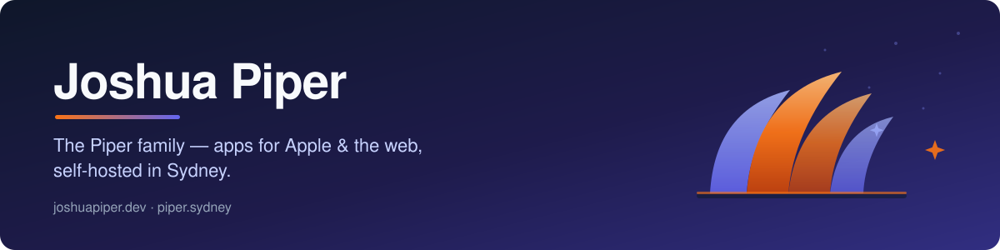
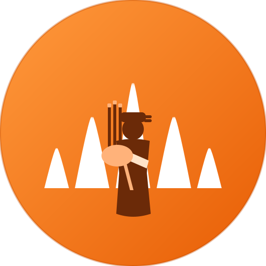

Software engineer in **Sydney, Australia** 🇦🇺. After three years of heads-down work, this profile is the reboot: I build the **Piper family** with AI agents as my pair-programmers, and self-host everything behind it. The professional side lives on [joshuapiper.dev](https://joshuapiper.dev).

## 📱 Apps

| | App | What it is |
|---|---|---|
|  | [**YoMamma**](https://yomamma.piper.sydney) | Sunsama-style daily planner |
| 🗓️ | [**Dayglass**](https://dayglass.joshuapiper.dev) | Calendar & tasks, natural-language entry |
| 🎯 | [**Focusy**](https://joshuapiper.dev/projects/focusy/) | Calm visual planning, focus & time tracking |
|  | [**MindCanvas Studio**](https://mindcanvas.piper.sydney) | Whiteboard for web & Apple devices |
| 📋 | [**Clipstack**](https://joshuapiper.dev/projects/clipstack/) | Clipboard history, folders & pinboards |
| 🌊 | [**Drift**](https://joshuapiper.dev/projects/drift/) | Arc-style personal browser |
|  | [**Recipes**](https://joshuapiper.dev/projects/recipes/) | Meal planning & shopping lists on my [Mealie](https://mealie.io) |
|  | [**ForMyLife**](https://budget.piper.sydney) | A calm, four-rule life budget |
| 🔁 | [**SubbyScrubby**](https://joshuapiper.dev/projects/subscription-manager/) | Renewals, trials & plan comparisons |
|  | [**Snapmark**](https://joshuapiper.dev/projects/snapmark/) | Screenshots, markup, OCR & library |
| 🎧 | [**Listenable**](https://joshuapiper.dev/projects/listenable/) | Reddit & articles, cleaned up for listening |
| ⛳ | [**Game 01**](https://joshuapiper.dev/future/game-01/) | A future Piper idea — concept stage |

## 🛠 Mac utilities

| | App | What it is |
|---|---|---|
| 🥾 | [**Booter**](https://joshuapiper.dev/projects/booter/) | Set up a new Mac in one pass |
| 🐢 | [**SlowDown**](https://joshuapiper.dev/projects/slowdown/) | Wi-Fi, Ethernet & VPN diagnosis |
| 🧹 | [**SpaceKeeper**](https://joshuapiper.dev/projects/spacekeeper/) | Keeps the Mac's disk free |
| 🗜️ | [**Presso**](https://joshuapiper.dev/projects/presso/) | Shrinks images, no visible change |

## 🤖 AI & developer tools

| | App | What it is |
|---|---|---|
| 🧠 | [**AiWhoDat**](https://joshpiper1505workplace.github.io/aiwhodat/) | Reusable agent skills, scripts & memory |
| 🎛️ | [**Piper HQ**](https://joshuapiper.dev/projects/piper-hq/) | Control centre for every app |
| 🗼 | [**TowerControl**](https://joshuapiper.dev/projects/piper-hq/#towercontrol) | The history of everything you build |
| ✅ | [**Checkpoint**](https://joshuapiper.dev/projects/checkpoint/) | The checks only a person can do |
| 🎮 | [**ALearner**](https://joshuapiper.dev/projects/alearner/) | Learn agentic coding as a game |
| 🔌 | [**Resty**](https://joshuapiper.dev/projects/resty/) | REST API client (Bruno fork) |
| 📡 | [**PiperRay**](https://joshuapiper.dev/projects/piperray/) | Raycast extensions |
| 🔗 | [**Piper Go**](https://joshuapiper.dev/projects/piper-go/) | Short links at [piper.sydney/go](https://piper.sydney/go/) |
| 📮 | [**Piper Outbox**](https://joshuapiper.dev/projects/piper-outbox/) | Write once, approve, then send |

## 🌐 Web & self-hosted

| | Project | What it is |
|---|---|---|
| ✍️ | [**Blog**](https://joshuapiper.dev/blog/) | My writing, built with Quartz |
|  | [**Piper**](https://piper.sydney) | The self-hosted stack behind it all |
| 📚 | **Knowledge base** | Private Obsidian operations wiki |

[**Developer workspace guide →**](docs/code-workspace.md)

Most code lives in private repos while it matures — happy to talk about any of it. Also owned: joshpiper.com · joshuapiper.com.
