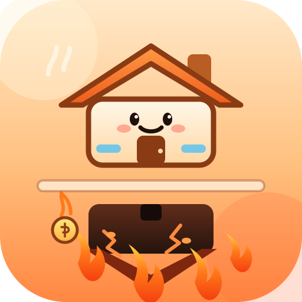
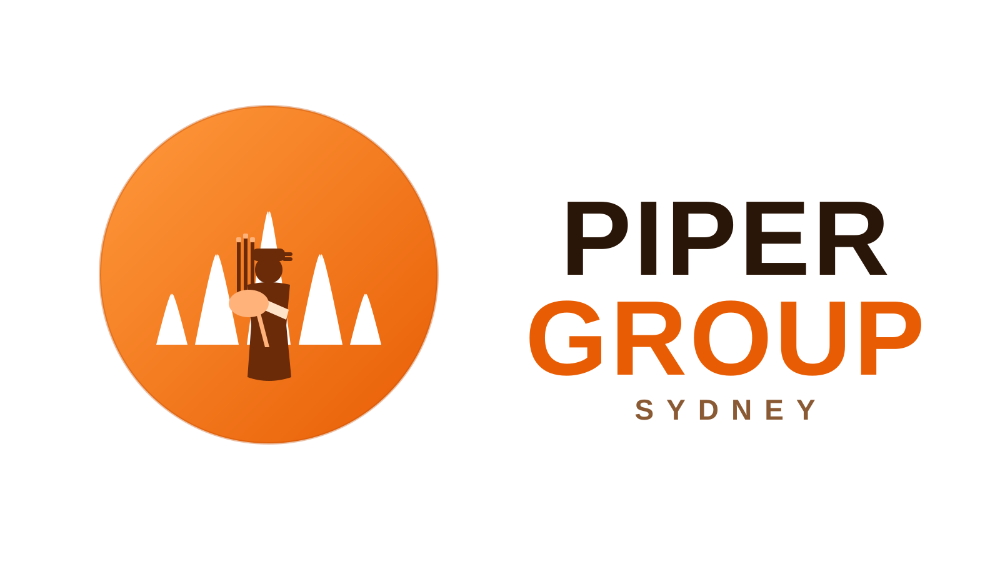

# Joshua Piper

**A reboot of my online presence after three years of heads-down work — building my own apps again.**

Software engineer in **Sydney, Australia** 🇦🇺. I build the **Piper family** — native apps for Mac, iPhone and iPad, web apps, and the self-hosted plumbing behind them — mostly pair-programming with AI agents. The professional side lives on [joshuapiper.dev](https://joshuapiper.dev); this profile is what I build for myself. Before the reboot: [my old GitHub profile](https://github.com/Josh-Piper).

## 📱 Apps

| | App | What it is |
|---|---|---|
|  | [**YoMamma**](https://yomamma.piper.sydney) | Sunsama-style daily planner for iPhone, iPad, Mac & web |
| 🗓️ | [**Dayglass**](https://dayglass.joshuapiper.dev) | Calendar & tasks with natural-language entry |
| 🎯 | [**Focusy**](https://joshuapiper.dev/projects/focusy/) | Calm visual planning, focus & time tracking |
|  | [**MindCanvas Studio**](https://mindcanvas.piper.sydney) | Whiteboard for web, iPhone, iPad & Mac |
| 📋 | [**Clipstack**](https://joshuapiper.dev/projects/clipstack/) | Clipboard manager with unlimited history, folders & pinboards |
| 🌊 | [**Drift**](https://joshuapiper.dev/projects/drift/) | Arc-style personal browser — Chromium on Mac, WebKit on iOS |
|  | [**Recipes**](https://joshuapiper.dev/projects/recipes/) | Meal planning & shopping lists for my self-hosted [Mealie](https://mealie.io) |
|  | [**ForMyLife**](https://budget.piper.sydney) | A calm, four-rule life budget on every device |
| 🔁 | [**SubbyScrubby**](https://joshuapiper.dev/projects/subscription-manager/) | Subscriptions: renewals, trials, cancellation links & plan comparisons |
|  | [**Snapmark**](https://joshuapiper.dev/projects/snapmark/) | Screenshot capture, markup, OCR & library for Mac |
| 🎧 | [**Listenable**](https://joshuapiper.dev/projects/listenable/) | Clean listening versions of Reddit & articles in Chrome/Safari |
| ⛳ | [**Piper's Putt Party**](https://joshuapiper.dev/future/game-01/) | Slingshot mini golf with pinball hazards & party pranks |

## 🛠 Mac utilities

| | App | What it is |
|---|---|---|
| 🥾 | [**Booter**](https://joshuapiper.dev/projects/booter/) | Set up a new Mac: installs, login items, permissions |
| 🐢 | [**SlowDown**](https://joshuapiper.dev/projects/slowdown/) | Native diagnosis for Wi-Fi, Ethernet, VPN & internet speed |
| 🧹 | [**SpaceKeeper**](https://joshuapiper.dev/projects/spacekeeper/) | Keeps the Mac's disk free — guards, caches & build cleanup |
| 🗜️ | [**Presso**](https://joshuapiper.dev/projects/presso/) | Shrinks images without visible change — a Clop for Unix |

## 🤖 AI & developer tools

| | App | What it is |
|---|---|---|
| 🧠 | [**AiWhoDat**](https://joshpiper1505workplace.github.io/aiwhodat/) | Reusable agent work: skills, scripts, flows & shared memory |
| 🎛️ | [**Piper HQ**](https://joshuapiper.dev/projects/piper-hq/) | Control centre for every app — CLI/TUI, Mac & iOS apps |
| 🗼 | [**TowerControl**](https://joshuapiper.dev/projects/piper-hq/#towercontrol) | The history of everything you build: logs, features & decisions |
| ✅ | [**Checkpoint**](https://joshuapiper.dev/projects/checkpoint/) | The checks only a person can do, across all your devices |
| 🎮 | [**ALearner**](https://joshuapiper.dev/projects/alearner/) | Learn agentic coding as a game |
| 🔌 | [**Resty**](https://joshuapiper.dev/projects/resty/) | REST API client (fork of Bruno) |
| 📡 | [**PiperRay**](https://joshuapiper.dev/projects/piperray/) | Raycast extensions for clipboard publishing & lists |
| 🔗 | [**Piper Go**](https://joshuapiper.dev/projects/piper-go/) | Short links at [piper.sydney/go](https://piper.sydney/go/) |
| 📮 | [**Piper Outbox**](https://joshuapiper.dev/projects/piper-outbox/) | Approval-first publishing: write once, approve, then send |

## 🌐 Web & self-hosted

| | Project | What it is |
|---|---|---|
| ✍️ | [**Blog**](https://joshuapiper.dev/blog/) | My writing, built with Quartz |
|  | [**Piper**](https://piper.sydney) | The self-hosted stack behind it all: Mealie, sites, nginx & deploys |
| 📚 | **Knowledge base** | My private Obsidian operations wiki, synced to the VPS |

[**Developer workspace guide →**](docs/code-workspace.md) — releases, deployment, iOS builds and verification.

Most code lives in private repos while it matures — happy to talk about any of it.
